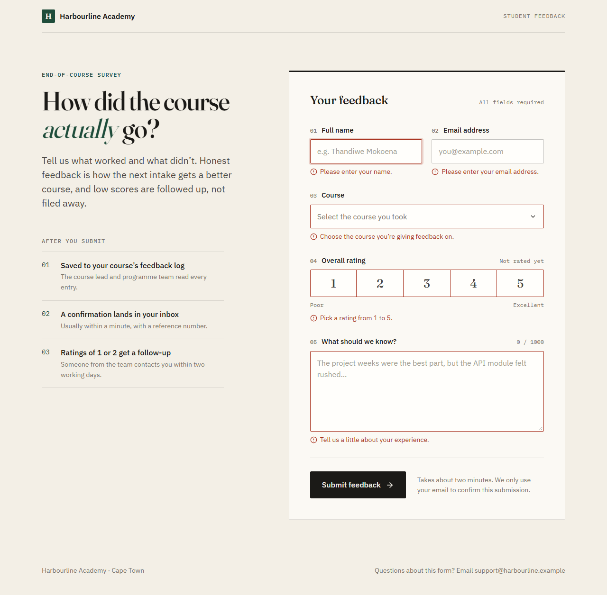
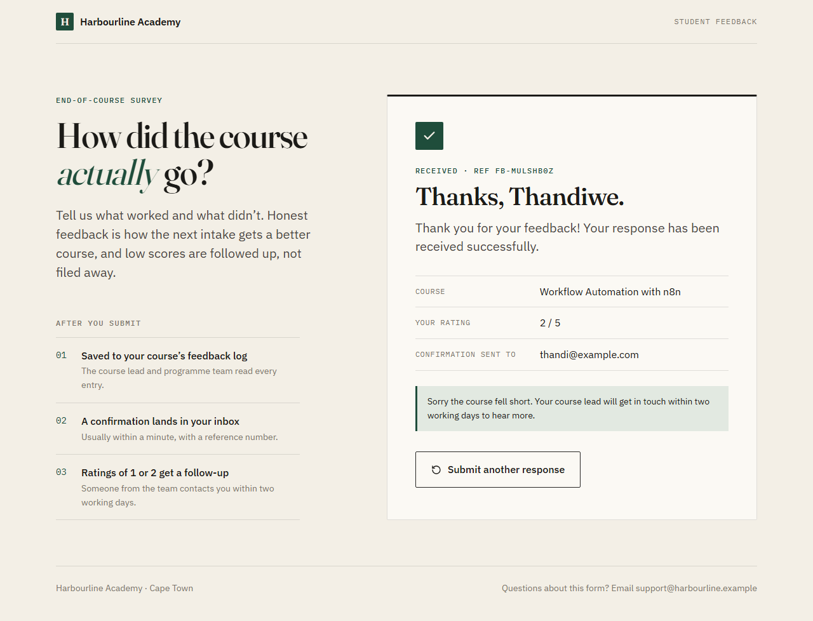
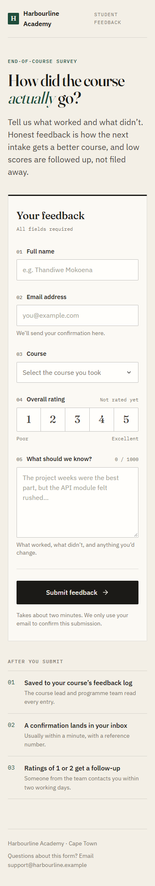

# Student Feedback: React form + n8n workflow

A course-feedback form for a made-up training company, Harbourline Academy, and the n8n workflow behind it. The form posts each submission to an n8n webhook. The workflow checks it, flags low ratings, saves it to Google Sheets and emails the student a thank-you.

| Form | After submitting a rating of 2 | On a phone |
|---|---|---|
|  |  |  |

## Where each part of the brief is

| Brief | Where |
|---|---|
| Part 1: React form with name, email, course, rating (1-5), message and submit button; client-side validation; Fetch API; success and error messages; responsive | `feedback-form/` (the form is `src/components/FeedbackForm.jsx`, the rules `src/utils/validation.js`, the request `src/api/submitFeedback.js`) |
| Part 2: n8n workflow: webhook, validation, Google Sheets, rating ≤ 2 / > 2, email notification | `n8n-workflow/student-feedback-workflow.json` |
| Part 3: Loom video | Submitted separately |

## Running the form

```bash
cd feedback-form
npm install
cp .env.example .env        # then set VITE_N8N_WEBHOOK_URL (see below)
npm run dev                 # http://localhost:5173
```

`npm run build` makes a production build in `feedback-form/dist/`.

## Setting up the workflow

1. **Import it.** In n8n, import `n8n-workflow/student-feedback-workflow.json` (Import from File).
2. **Make the sheet.** Create a Google Sheet with a tab called `Feedback` and this header row:

   | Submitted At | Reference | Student Name | Email | Course | Rating | Feedback | Status |
   |---|---|---|---|---|---|---|---|

   Copy the sheet's ID from its URL (the part between `/d/` and `/edit`) and paste it into the **Save to Google Sheets** node in place of `PASTE_YOUR_GOOGLE_SHEET_ID_HERE`.
3. **Connect Google.** Add a Google Sheets credential to **Save to Google Sheets** and a Gmail credential to **Send Thank-You Email**. On n8n Cloud that's a sign-in button. On self-hosted n8n it needs an OAuth client from Google Cloud first; n8n's guide is at <https://docs.n8n.io/integrations/builtin/credentials/google/oauth-single-service/>, and the redirect URL to give Google is shown in n8n's credential window.
4. **Point the form at it.** Activate (publish) the workflow and copy the **Production URL** from the **Receive Feedback** node into `feedback-form/.env`:

   ```
   VITE_N8N_WEBHOOK_URL=http://localhost:5678/webhook/student-feedback
   ```

   Use your own n8n's address and port. Restart `npm run dev` after changing `.env`, because Vite only reads it at start-up. While building in the editor you can use the Test URL (`/webhook-test/...`) instead, clicking "Listen for test event" before each submission.

## How the workflow works

```
Receive Feedback -> Validate & Clean Data -> Is Data Valid? -- no --> Reply: Invalid (400)
                                                  | yes
                                                  v
                                          Rating 2 or Lower? -- yes --> Mark: Needs Attention --+
                                                  | no                                          |
                                                  +-----------> Mark: Positive -----------------+
                                                                                                v
                                     Reply: Success (200) <- Send Thank-You Email <- Save to Google Sheets
```

| Node | What it does |
|---|---|
| **Receive Feedback** (Webhook) | `POST /student-feedback`. Set to answer from a Respond to Webhook node, so the form gets a real success or error reply instead of an instant "received". |
| **Validate & Clean Data** (Code) | Trims every field, lowercases the email and checks each field with the same rules as the form. It collects every problem rather than stopping at the first, so the form can mark all the bad fields at once. It also escapes the message for the HTML email and creates a reference like `FB-MULSHB0Z` plus a timestamp. |
| **Is Data Valid?** (IF) | Sends bad submissions to **Reply: Invalid (400)**, which returns `{"ok": false, "message": ..., "errors": [{"field": "email", "message": ...}]}`. Nothing is saved. |
| **Rating 2 or Lower?** (IF) | 1 or 2 go to **Mark: Needs Attention**, 3 to 5 to **Mark: Positive**. Both Set nodes add a `status` field. This happens before saving, so the status lands in the same row. |
| **Save to Google Sheets** | Appends one row per submission, including the status. |
| **Send Thank-You Email** (Gmail) | HTML email with a copy of what the student wrote. Low ratings get an apology and a promise of a follow-up. It's set to continue on error: the row is already saved, so a Gmail problem shouldn't turn a saved submission into an error for the student. |
| **Reply: Success (200)** | `{"ok": true, "reference": "FB-...", "message": "Thank you for your feedback! Your response has been received successfully."}` |

## Why some things are done this way

- **Validation happens twice.** The form checks as you go, so people get instant feedback. The workflow checks again because anyone can post to a webhook without using the form. Both require a name, a valid email, a course, a whole number from 1 to 5 and a message of 10 to 1,000 characters (the form also turns away one-letter names), and `validation.js` says to keep them in sync.
- **Errors come back per field.** If n8n rejects something, the form shows the message in the red banner and next to the field it's about.
- **The form gives up after 15 seconds.** A stalled workflow would otherwise leave the button spinning forever.
- **The rating is a row of real radio buttons** styled as a scale, so arrow keys and screen readers work without extra code.
- **Errors only appear once you've left a field.** Nobody gets told their email is invalid halfway through typing it.

## Testing

Checked on 28 September 2026 against n8n 2.40.7 running in Docker:

- The workflow file imports into n8n 2.40.7.
- A `POST` with every field wrong comes back `400` with all five problems listed.
- The browser's CORS preflight from `http://localhost:5173` gets `204` with `Access-Control-Allow-Origin` set, so the form can post to n8n from a different port.
- The form itself, driven in headless Chromium (Playwright). This ran against a copy of the workflow with **Save to Google Sheets** disabled and **Send Thank-You Email** swapped for a Set node that returns the email it would have sent, because no Google account was connected on this machine. 11 of 11 checks passed:
  - the empty form shows an error on all 5 fields, sends nothing, and puts focus on the first bad field;
  - a bad email address is caught;
  - a rating of 2 reaches n8n, comes back `200` with a reference, the success panel shows that reference and the follow-up note, and n8n marked it `Needs Attention` (the returned email had the apology paragraph);
  - a rating of 5 succeeds without the follow-up note;
  - a `400` from n8n shows in the banner and next to the email field;
  - an unreachable n8n shows "We couldn't reach the feedback service";
  - at 375 px wide the page fits with no sideways scrolling.

**Not tested:** the real Google Sheets append and Gmail send. They need a Google account connected (step 3 above).
